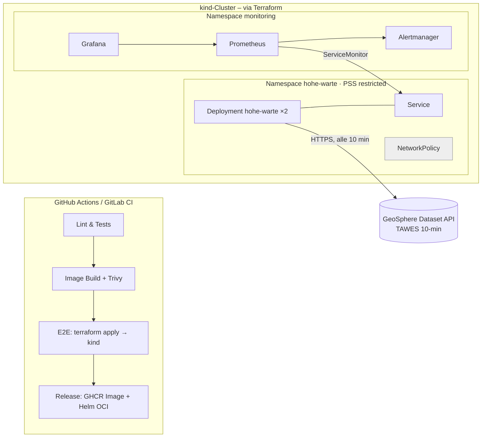

# hohe-warte-platform

[](../../actions/workflows/ci.yml)

Eine kleine, aber vollständige **Kubernetes-Plattform als Code**: Ein Python-Dienst holt aktuelle
Messwerte des TAWES-Stationsnetzes aus dem öffentlichen
[GeoSphere Austria Data Hub](https://dataset.api.hub.geosphere.at) (Standard: Wien/Hohe Warte 11035,
Wien/Innere Stadt 11034) und stellt sie als REST-API und Prometheus-Metriken bereit. Build, Test,
Security-Scan, Provisionierung des Clusters, Monitoring und Deployment sind vollständig automatisiert.

> Persönliches Lern- und Portfolio-Projekt. Keine offizielle Software der GeoSphere Austria;
> es nutzt ausschließlich die öffentlich dokumentierte Dataset API.

## Was das Repo zeigt

| Thema | Umsetzung | Dateien |
|---|---|---|
| Container | Multi-Stage-Build, Non-Root (UID 10001), read-only Root-FS, keine Capabilities, OCI-Labels, Healthcheck | `Dockerfile` |
| Kubernetes | Helm-Chart mit Deployment (Rolling Update, Startup-/Liveness-/Readiness-Probes), PDB, HPA, Ingress, NetworkPolicy (default-deny), Pod Security „restricted“, Helm-Test | `deploy/helm/hohe-warte` |
| Infrastructure-as-Code | Terraform erzeugt kind-Cluster (1 Control-Plane + N Worker), Namespaces, installiert kube-prometheus-stack und die App | `infra/terraform` |
| Monitoring / Alerting | Eigene Metriken (`/metrics`), ServiceMonitor, PrometheusRule mit 4 Alerts inkl. Runbook, Grafana-Dashboard als ConfigMap (Sidecar-Provisioning) | `templates/servicemonitor.yaml`, `prometheusrule.yaml`, `dashboards/` |
| Logging | Strukturierte JSON-Logs auf stdout (bereit für Loki/Fluent Bit) | `app/src/hohe_warte/main.py` |
| CI/CD | GitHub Actions: Lint → Unit-Tests → hadolint/helm lint/kubeconform/terraform validate → Image-Build + Smoke-Test + Trivy-Scan → **E2E auf echtem kind-Cluster via Terraform** → Release von Image (SBOM, Provenance) und Helm-Chart (OCI) nach GHCR. GitLab-CI-Pendant für Self-Hosted-GitLab | `.github/workflows/ci.yml`, `.gitlab-ci.yml` |

## Architektur



Details: [docs/ARCHITEKTUR.md](docs/ARCHITEKTUR.md) · Alerts: [docs/RUNBOOK.md](docs/RUNBOOK.md) · Fehleranalysen: [docs/LESSONS-LEARNED.md](docs/LESSONS-LEARNED.md)

## Schnellstart

Voraussetzungen: Docker, kind ≥ 0.33 (für Kubernetes 1.36), kubectl, Helm, Terraform ≥ 1.6.

```bash
make up          # Image bauen, kind-Cluster + Monitoring + App provisionieren (~5 min)
make status
kubectl -n hohe-warte port-forward svc/hohe-warte 8080:80 &
curl localhost:8080/api/v1/stations/11035/current
make grafana     # Dashboard „hohe-warte – GeoSphere TAWES & Service-Health“
make down
```

Nur die App lokal: `make run` → <http://localhost:8080/docs> (OpenAPI).

## API

| Endpunkt | Zweck |
|---|---|
| `GET /api/v1/stations` | Stationen mit vorliegenden Daten |
| `GET /api/v1/stations/{id}/current` | Jüngste Messwerte (TL, RF, FF, P, RR) |
| `GET /metrics/` | Prometheus-Metriken |
| `GET /healthz` / `GET /readyz` | Liveness / Readiness (nicht bereit, wenn Daten älter als `MAX_STALENESS_SECONDS`) |

Beispiel-Metrik: `geosphere_observation{station_id="11035",parameter="TL",unit="°C"} 6.3`

## Konfiguration

Alle Werte über Umgebungsvariablen bzw. `values.yaml` → `config.*`:
`STATION_IDS`, `PARAMETERS`, `POLL_INTERVAL_SECONDS`, `MAX_STALENESS_SECONDS`, `GEOSPHERE_API_BASE`.

## Entscheidungen

- **kind statt Managed-Cluster** – reproduzierbar, kostenlos, in CI lauffähig. Der Terraform-Aufbau
  trennt Cluster-Provisionierung von den Helm-Releases; für Proxmox/vSphere-VMs (z. B. mit kubeadm
  oder RKE2) oder einen Managed-Cluster wird nur die Cluster-Ressource ersetzt.
- **Helm statt reiner Manifeste** – parametrisierbar für mehrere Zielumgebungen (dev/staging/prod).
- **Monitoring als Teil des Charts** – ServiceMonitor, Alerts und Dashboard werden mit der App
  versioniert und ausgerollt („you build it, you monitor it“).
- **Security by default** – Non-Root, read-only FS, `drop: ALL`, seccomp, default-deny-Netzwerk,
  kein ServiceAccount-Token, Image-Scan als Gate in der Pipeline.
